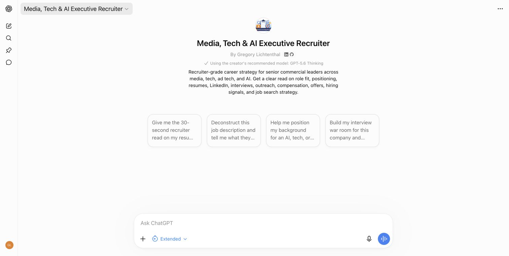

# Media, Tech & AI Executive Recruiter

Recruiter-style career strategy for business-side roles across media, technology, ad-tech, and AI. The project applies structured judgment to positioning, resumes, LinkedIn, interviews, outreach, offers, and job-search decisions.

It is an applied example of **judgment infrastructure for human-led AI**: organize the evidence, pressure-test assumptions, identify trade-offs, and help the person decide what to do next.

**Current plugin: private, version 0.67.0.** This public repository documents the project; it does not distribute the plugin or grant access to it.

## Product history and availability

| Stage | History | Availability as checked October 31, 2026 |
| --- | --- | --- |
| Original custom GPT | Launched publicly for others to use. The historical v1.0 release record is dated July 21, 2026. | The [original GPT URL](https://chatgpt.com/g/g-69c612c858188191a9d6d98fddd5b5b6-media-tech-ai-executive-recruiter) now shows a migration notice in the creator's signed-in session. Continued access for other users has not been independently verified. |
| Current plugin | Media, Tech & AI Executive Recruiter, version **0.67.0**; compared with 0.66.2 in the testing below. | **Private.** Former GPT users do not automatically receive access. No public plugin release is represented by this repository. |

The original GPT page displayed “Keep using GPT” and a notice that it could be used until December 11 when checked on October 31. This is a dated observation from one authorized account, not a guarantee of continued or public access. The original URL is retained as a historical reference rather than an unconditional “Try now” link. The older screenshot below is also historical.

Custom GPT release labels such as v1.0, plugin versions such as 0.67.0, and the separate private implementation's 1.2.x version history are distinct version tracks. They do not establish that all implementations contain identical behavior or are synchronized.

Preserving public access remains a goal. Public plugin submission is a separate step requiring its own eligibility check, submission preparation, review, and approval. GitHub publication does not make the plugin publicly usable. This documentation update does not modify product behavior, sharing settings, or plugin releases.

## Who it is for

Candidates pursuing enterprise sales, strategic accounts, partnerships, business development, GTM, revenue, growth, and commercial leadership roles. It is especially relevant when a candidate needs to make scope, ownership, results, and role fit clearer across media, platforms, ad-tech, software, and AI.

## Capabilities

| Career decision | What the assistant helps produce |
| --- | --- |
| Positioning and materials | A clearer role thesis; evidence-based resume and LinkedIn edits; questions that resolve missing proof. |
| Role fit | A distinction between explicit requirements, inferred hiring screens, proven fit, adjacent experience, and unknowns. |
| Interview preparation | Stage-specific preparation, proof stories, objections, questions, case critiques, and one-question-at-a-time practice. |
| Outreach | Concise drafts that preserve supplied facts and sentiment without inventing enthusiasm or commitments. |
| Offers | Cash and equity scenarios, quota and payout questions, role-quality trade-offs, and negotiation preparation. |
| Search and process signals | Focused search priorities, plausible interpretations of ambiguous hiring behavior, and practical next steps. |
| AI-commercial preparation | Credible discussion of customer workflows, evaluation, adoption, reliability, economics, and deployment constraints without fabricating technical experience. |

These are intended capabilities, not guarantees that every answer is correct. Current research depends on tools actually available in the host. Model choice, browsing, memory, and integrations belong to that host; the plugin does not enable or select them by itself.

## Fictional examples

All facts and amounts below are fictional. They are not personal career materials or hiring outcomes.

**Conflicting scope:** One resume says “managed nine sellers”; another says “individual contributor on a nine-person team.” The useful result is a provisional draft and a question about actual ownership, rather than a confident management claim.

**Offer comparison:** At explicitly linear payout, $176,000 base plus $144,000 target variable at 62.5% attainment yields $266,000 annual cash. A second offer of $240,000 base plus a guaranteed $20,000 bonus yields $260,000. The $6,000 difference does not make the first offer's $320,000 OTE guaranteed.

**Options:** 18,000 options over 12,000,000 fully diluted shares represent 0.15% at that capitalization. A $4.50 strike means $81,000 to exercise all options. A $17 preferred funding-round price does not guarantee common-share proceeds or realizable option value.

**AI interview:** A candidate with personal AI chat use but no deployment experience can propose comparing models on representative customer tasks, success criteria, quality, reliability, latency, cost, privacy, integration, and rollout requirements. The answer should not turn that proposed approach into claimed past experience.

See [fictional example outputs](example-outputs.md), [sample prompts](sample-prompts.md), and [use cases](use-cases.md).

## Verified testing results

On **October 31, 2026**, the 0.66.2 and 0.67.0 instruction packages were compared using **GPT-6.1 Sol (`gpt-6.1-sol`) at medium reasoning effort through Codex**. The runtime configuration identified the selected model and provider. GPT-6.1 Sol is described here only as the testing environment; this is not a product model requirement or a claim that the plugin selects that model.

**40 controlled runs = 10 fictional cases × 2 repetitions × 2 versions.** Each run used a fresh session with the version's instructions and relevant references. Cases covered conflicting resumes, corrections, cash, payout thresholds, options, brief outreach, malicious posting text, AI-adoption interview answers, interview openings, and missing role-fit evidence.

| Result | Previous 0.66.2 | Current 0.67.0 |
| --- | ---: | ---: |
| Checks passed | **20/20** | **20/20** |
| Average response length | 62.4 words | 61.8 words |
| Mean input tokens, including common host context | 19,472.5 | 20,670.6 |

The newer version provided a more explicit AI-evaluation checklist and used 6.15% more input context in this setup. **No correctness improvement or regression was demonstrated in this sample.**

These were Codex tests of the instruction packages, **not a complete ChatGPT plugin integration benchmark**, a comparison against an older model, or evidence of better hiring outcomes. Review was manual and the reviewer knew the version. Two repetitions per case do not establish statistical reliability. The prompts were synthetic and often explicit about desired constraints. No tool calls occurred in the scored responses.

The [testing summary](testing.md) and [sanitized per-run metrics](testing/gpt61-comparison-results.csv) provide the public evidence. Raw logs, source snapshots, proprietary instructions, and packaged reference files are excluded. Historical custom-GPT validation is kept separately under [release/v1.0](release/v1.0/README.md); it was not rerun or independently re-scored for this update.

## Limitations and privacy

- This is an independent project, not an official OpenAI product, recruiter service, or source of insider hiring information.
- It can make mistakes, miss context, or offer weak interpretations. Verify important facts, arithmetic, current openings, and company claims before acting.
- It cannot guarantee interviews, offers, compensation, recruiter replies, or hiring decisions.
- Legal, tax, immigration, and financial questions require appropriate professional advice. Fictional compensation examples illustrate arithmetic rather than a recommendation about a real offer.
- Share only information you are authorized to use. Redact unnecessary identifiers and employer-confidential details; use fictional or aggregated examples for public demonstrations.
- Data handling depends on the host, account settings, and connected services. Review their current privacy information before providing sensitive material.
- A draft is not authorization to contact someone, submit an application, accept an offer, or change a public profile. People retain responsibility for those decisions and actions.

This repository's current files exclude proprietary instruction text, packaged knowledge files, private resumes, and personal career materials. The historical instruction snapshot was removed from the current files in this documentation update; earlier Git history may still contain that previously published material. No history rewrite is claimed. See [limitations and privacy](limitations-and-privacy.md).

## Public design and portfolio context

The public architecture describes subject areas and design principles rather than publishing the implementation: evidence before persuasion, scope before title, role fit before prestige, calibrated uncertainty, and critique paired with a practical next move. Supporting explanations are in [knowledge architecture](knowledge-architecture.md) and [design principles](design-principles.md).

This project is separate from the four core skills—The Briefing Room, Ground Truth, The Quorum, and Test Drive. It applies the same human-led judgment approach to commercial career decisions. [Explore the broader portfolio](https://github.com/glichtenthal).

## Repository contents

- `README.md`: complete project overview, product history, availability, examples, testing, and limitations.
- [sample-prompts.md](sample-prompts.md) and [use-cases.md](use-cases.md): public starting points and career scenarios.
- [knowledge-architecture.md](knowledge-architecture.md) and [design-principles.md](design-principles.md): sanitized design summaries.
- [limitations-and-privacy.md](limitations-and-privacy.md): data boundaries and responsible use.
- [testing.md](testing.md), [per-run metrics](testing/gpt61-comparison-results.csv), and [example-outputs.md](example-outputs.md): sanitized evaluation reporting and fictional examples.
- [changelog.md](changelog.md): separate GPT, plugin, and documentation history.
- [release/v1.0](release/v1.0/README.md): historical public-GPT documentation.
- [PROFILE_README_SNIPPET.md](PROFILE_README_SNIPPET.md): concise integration into the existing profile section.
- [assets/screenshots](assets/screenshots/README.md): historical public-GPT preview.

## Historical preview

This image records the original custom GPT. It does not establish current availability, model selection, or access to the plugin.
